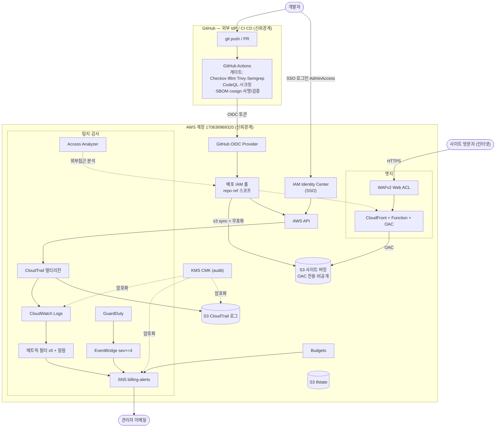

# 위협 모델 — devsecops-portfolio

/ 방법론: STRIDE · 범위: AWS 계정 170638969320 의 정적 사이트 + CI/CD + 가드레일

이 문서는 구축된 통제를 **위협 관점에서 재검토**하고, 각 위협을 기존 통제에
매핑한 뒤 **잔여 위험**을 우선순위화한다. 통제 목록이 아니라 "무엇을 막고,
무엇이 남는가"를 본다.

## 1. 범위와 자산

**시스템.** GitHub 로 관리하는 정적 포트폴리오 사이트를 AWS(S3+CloudFront)에
배포하고, 공급망 서명·계정 가드레일·탐지 파이프라인을 붙인 구성.

**보호 자산 (중요도순).**

| 자산 | 침해 시 영향 |
|---|---|
| AWS 계정 제어(루트/SSO AdministratorAccess) | 전체 장악 — 최상위 |
| CI/CD 배포 경로(OIDC 배포 롤) | 사이트 변조·공급망 침투 |
| Terraform 상태(tfstate) | 인프라 전체 형상·비밀 노출 |
| CloudTrail 로그·KMS CMK | 감사 추적 무력화, 암호화 우회 |
| 사이트 콘텐츠(S3+CloudFront) | 변조·평판 훼손 |

**신뢰 경계.** ①인터넷 ↔ CloudFront/WAF, ②GitHub(외부 IdP·러너) ↔ AWS(OIDC),
③SSO 관리자 ↔ AWS 계정, ④AWS 계정 내부.

**위협 행위자.** 익명 인터넷 공격자, 악의적/탈취된 GitHub 신원(계정·토큰),
공급망(의존성·액션) 공격자, 탈취된 관리자 자격증명.

## 2. 데이터 플로우 다이어그램

## 3. STRIDE 분석

각 위협을 **기존 통제**와 **잔여 위험**에 매핑한다. `[검증]` 은 침투검증
워크플로/ADR 로 실제 동작을 확인한 통제.

### S — Spoofing (위장)

| 위협 | 기존 통제 | 잔여 위험 |
|---|---|---|
| 배포 신원 위장(배포 롤 탈취) | GitHub OIDC, 장기 키 없음, repo·ref 스코프 trust `[검증: ADR 0010, oidc-trust-boundary-test]` | GitHub 계정/토큰 탈취 시 스코프 내 배포 가능 |
| 관리자 위장 | IAM Identity Center(SSO), 계정 암호정책 | **콘솔 로그인 MFA 강제 신호 없음**(sign_in_without_mfa 보류) |
| 방문자에게 사이트 위장 | CloudFront TLS, WAF | 커스텀 도메인·DNSSEC 없음(기본 cloudfront.net 인증서) |

### T — Tampering (변조)

| 위협 | 기존 통제 | 잔여 위험 |
|---|---|---|
| CI 산출물 변조 | SBOM + cosign keyless 서명 + verify 게이트 `[검증: ADR 0011, signing-tamper-test]` | — (변조→거부 실측) |
| 사이트 콘텐츠 변조(S3) | OAC 전용·퍼블릭 차단, 버킷정책, 버전닝, 스코프 배포 롤 `[검증: deploy-role-boundary-test]` | MFA delete 미적용(수용) |
| IaC 변조 | PR 게이트(Checkov·tflint·억제검증), 액션 SHA 고정 `[ADR 0005]`, 브랜치 보호 | — |
| 전송 중 변조 | HTTPS(CloudFront) | — |
| tfstate 변조 | S3 버전닝·암호화·접근 제한 | 상태 잠금(DynamoDB) 없음 — 동시 apply 경합(단독 운영이라 낮음) |
| 로그 변조/중단 | CloudTrail→S3(버전닝)+CWL, StopLogging/DeleteTrail/UpdateTrail/Create·StartLogging 메트릭 필터+알람 `[CIS 3.5 커버]` | 로그 버킷 MFA delete 미적용(수용) |

### R — Repudiation (부인)

| 위협 | 기존 통제 | 잔여 위험 |
|---|---|---|
| 관리 행위 부인 | CloudTrail 멀티리전 → S3+CWL, 민감 변경 메트릭 필터+알람→SNS | — |
| 탐지 무력화 후 부인 | 트레일 변경 필터, CMK 키 정책 변경 필터(audit-key-change) | — |

### I — Information Disclosure (정보 노출)

| 위협 | 기존 통제 | 잔여 위험 |
|---|---|---|
| 코드 내 비밀 노출 | gitleaks(pre-commit+CI), Trivy secret, Semgrep, CodeQL | — |
| S3 퍼블릭 노출 | 계정 레벨 + 버킷별 Public Access Block | — |
| 로그/상태 노출 | KMS CMK 암호화, 버킷정책, PAB | — |
| 과다 권한으로 노출 | Access Analyzer(외부접근) + 의도선언 아카이브 룰, 스코프 배포 롤 | **SSO AdministratorAccess 권한셋** (아래 P1) |

### D — Denial of Service (서비스 거부)

| 위협 | 기존 통제 | 잔여 위험 |
|---|---|---|
| 사이트 DoS | CloudFront(흡수) + WAFv2 + Shield Standard | WAF 로깅 미적용(보류) |
| 비용성 DoS(리소스 남용) | Budgets(일/월) + 청구 알람 → SNS | — |
| 탐지 파이프라인 DoS | 트레일 중단 필터, GuardDuty | — |

### E — Elevation of Privilege (권한 상승)

| 위협 | 기존 통제 | 잔여 위험 |
|---|---|---|
| 배포 롤 권한 초과 | 최소권한 배포 정책 `[검증: deploy-role-boundary-test]` | — |
| IAM 정책 변경을 통한 상승 | iam-policy-change 메트릭 필터+알람 | 탐지는 하나 예방은 아님 |
| KMS 키 정책 변경 | audit-key-change 필터+알람 | 동일 |
| **SSO 관리자 권한 과다** | 탐지됨(Prowler), 억제 안 함 | **AdministratorAccess 권한셋 — 최대 폭발 반경 (P1)** |

## 4. 잔여 위험 레지스터 (우선순위)

| # | 잔여 위험 | STRIDE | 심각도 | 상태/계획 |
|---|---|---|---|---|
| R1 | SSO `AdministratorAccess` 권한셋 — 단일 과다권한, 폭발 반경 최대 | E/I | High | 업무별 스코프 권한셋 분리 + break-glass admin 유지 (수정 백로그) |
| R2 | 콘솔 로그인 MFA 강제 신호 없음 | S | Medium | SSO MFA 정책 확인/강제, sign_in_without_mfa 필터 추가 검토 |
| R3 | GitHub 계정/토큰 탈취 시 스코프 내 배포 | S/T | Medium | 브랜치 보호·환경 승인·서명 게이트로 완화됨; 하드웨어 2FA 권장 |
| R4 | tfstate 상태 잠금 부재 | T | Low | 단독 운영이라 낮음; S3 네이티브 lockfile 또는 DynamoDB 도입 검토 |
| R5 | WAF 로깅 미적용 | D/R | Low | 비용 절충, revisit=2027-05-31 (Prowler mutelist) |
| R6 | 커스텀 도메인·DNSSEC 없음 | S | Low | 커스텀 도메인 도입 시 함께 |

> R1 은 계정 전역 Prowler 스캔에서 **유일하게 미처리로 남은 실제 수정 대상**이며
> (나머지는 수정/근거억제/의도선언 처리), 이 위협모델의 최우선 개선 항목이다.

## 5. 검증된 통제 (실측 매핑)

이 프로젝트의 통제는 "통과가 통제를 뜻하지 않는다" 원칙에 따라 **공격으로 검증**했다.

| 통제 | 검증 방법 | 결과 |
|---|---|---|
| OIDC 신뢰 경계 | oidc-trust-boundary-test (다른 repo sub 로 assume 시도) | deny 확인 |
| 배포 롤 최소권한 | deploy-role-boundary-test (정책 밖 행위 시도) | deny 확인 |
| 산출물 서명 | signing-tamper-test (1바이트 변조 후 verify) | 거부(exit 1) 확인 |
| 탐지 알림 경로 | GuardDuty 샘플 발사 → EventBridge → SNS | 메일 실배달 확인 (KMS 키 정책 공백까지 규명·수정) |
| 로그 변경 탐지 | Prowler CIS 3.5 커버리지 측정 | Create/StartLogging 갭 발견·수정 |

## 6. 참고

- ADR: 0005(SHA 고정), 0007(스캐너 책임 분리), 0008(CMK=탐지 전제), 0010(파이프라인 침투검증), 0011(산출물 서명)
- 증거: docs/security-testing.md (케이스 1–14), docs/evidence/
- 트리아지: docs/prowler-triage.md (계정 전역 63건 분류)
